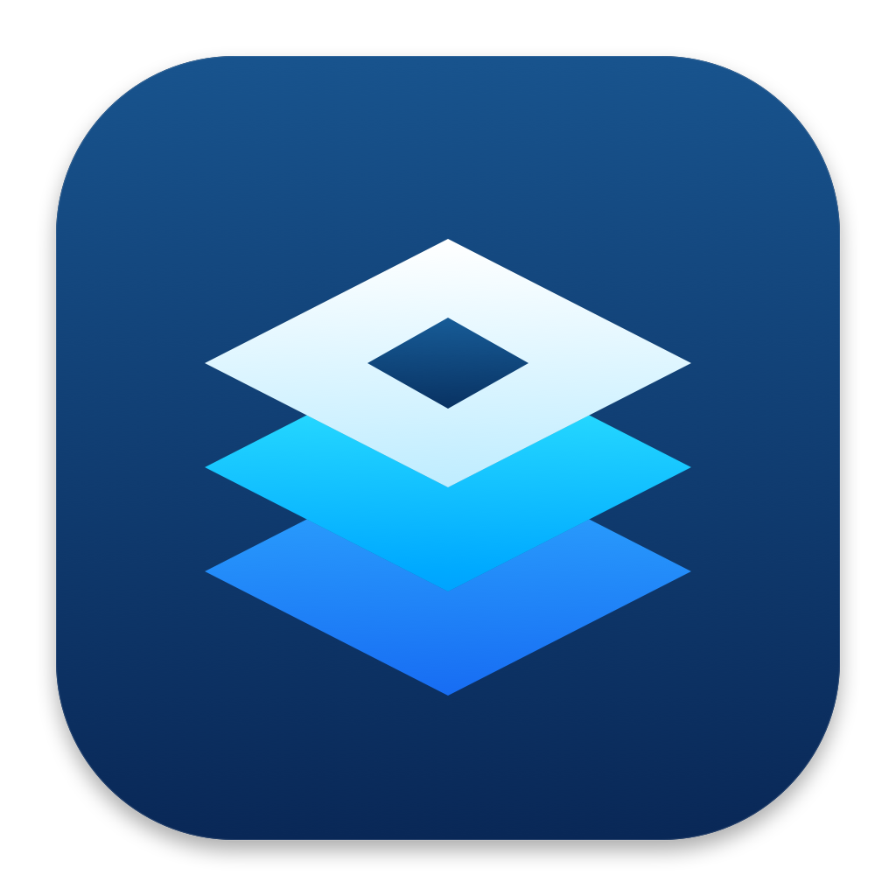

<p align="center">
  
</p>

<h1 align="center">MacBlox</h1>
<p align="center">a Roblox account manager for Mac :)</p>
<p align="center"><a href="https://github.com/flamses/Roblox-Mac-Account-Manager/releases/latest"><b>⬇️ download the app</b></a></p>

## what it does

- open multiple Roblox accounts at the same time
- send your alts to the same game or different games
- pick a public server or paste a private-server invite for your alts
- groups, favorites, notes and saved game links
- pause your launch queue and see which clients are running
- FPS settings + a custom app icon

## how to use

1. grab **MacBlox-v1.1.0-macOS-AppleSilicon.zip** from [releases](https://github.com/flamses/Roblox-Mac-Account-Manager/releases/latest)
2. unzip it and move **MacBlox** into Applications
3. have the official **Roblox.app** installed in Applications too
4. open MacBlox, add your accounts and paste a game link
5. select your alts with **Command-click**, then launch!

**macOS 14+ · Apple Silicon (M1 or newer)**

this is an early release, so there might still be bugs. it isn't Apple-notarized yet. if macOS blocks it, check **System Settings → Privacy & Security** for **Open Anyway**. only open a copy you trust.

## private servers

choose **Private server**, paste the invite, select your alts and launch. both long `/games/…?privateServerLinkCode=…` links and newer `/share?code=…&type=Server` links are accepted.

you can also save a private invite in each alt's game field and use **Per-account destinations**. leave the public Job ID blank. private links saved in profiles or presets stay in local app preferences — don't share them.

## a few things

- logins are saved in your Mac's Keychain. passwords aren't saved by MacBlox.
- same game doesn't always mean same server — use **Same public server** for that.
- FPS changes are global and need Roblox closed first.
- paste private-server invites in **Private server** mode. each alt still needs permission to join.
- Roblox updates can break things. if something goes wrong, [open an issue](https://github.com/flamses/Roblox-Mac-Account-Manager/issues).

## want to build it?

install Xcode command line tools and Swift 6, then run:

```sh
./script/build_and_run.sh
```

Intel Mac users can build from source on their Mac. the download above is Apple Silicon only.

made by [flamses](https://github.com/flamses). not affiliated with Roblox.
